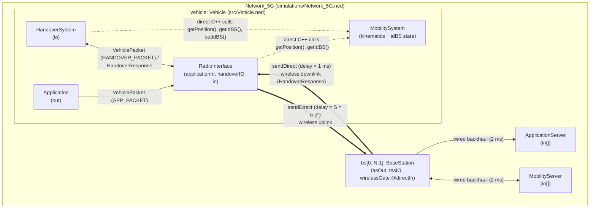

# 5G-Connected Vehicle — OMNeT++ Simulator Codebase Documentation

This document provides a technical reference for the **5G-Connected Vehicle** discrete-event simulator built with **OMNeT++** (C++17 / NED / `.msg`). It is intended for developers and reviewers who need to understand, maintain, or extend the codebase.

---

## 1. Architecture Overview

The simulator models a single 5G-enabled vehicle moving at constant speed $V$ along a straight highway of length $L$, served by $N$ equally spaced Base Stations ($\text{ISD} = L / (N - 1)$) connected via an ideal wired backhaul to an **Application Server (AS)** and a **Mobility Server (MS)**.

All C++ classes and `.msg` types live in the `_5g_connectedvehicle` namespace (declared via `@namespace(_5g_connectedvehicle)` in `src/package.ned` and explicitly in `.msg` files).

### Topology & Data Flows



### Packet Lifecycles

1. **Application Uplink Flow (One-Way):**
   `Application` $\to$ `RadioInterface` (shared FIFO + wireless service time $S = \alpha \cdot d^2$) $\xrightarrow{\text{sendDirect}}$ `bs[idBS]` $\xrightarrow{2\text{ ms}}$ `ApplicationServer` (records `endToEndDelay`, deletes packet).
2. **Handover Closed Loop (Round-Trip):**
   `HandoverSystem` (queries `MobilitySystem` for $x(t)$ and `idBS`) $\to$ `RadioInterface` (enters the **same** uplink FIFO queue, transmitted with $S = \alpha \cdot d^2$) $\xrightarrow{\text{sendDirect}}$ `bs[idBS]` $\xrightarrow{2\text{ ms}}$ `MobilityServer` (computes closest BS to `genTimePosition`, replies via the arrival gate index) $\xrightarrow{2\text{ ms}}$ `bs[arrivalIdx]` $\xrightarrow{\text{sendDirect, } 1\text{ ms}}$ `vehicle.wirelessGate` $\to$ `RadioInterface` (bypasses uplink queue, forwards via `handoverIO$o`) $\to$ `HandoverSystem` (updates `MobilitySystem::setIdBS`, records `handoverDelay`, deletes response).

---

## 2. Repository Structure & File Map

```text
5G-Connected Vehicle/
├── Makefile                        # Top-level wrapper delegating to src/Makefile
├── .oppbuildspec                   # OMNeT++ IDE build config (marks src/ as makemake)
├── simulations/
│   ├── package.ned                 # Declares NED package _5g_connectedvehicle.simulations
│   ├── Network_5G.ned              # Top-level network topology & display layout
│   ├── omnetpp.ini                 # Simulation parameters and experiment configurations
│   ├── General.anf                 # OMNeT++ Analysis Tool configuration
│   └── run                         # Helper launch script
└── src/
    ├── package.ned                 # Declares package & C++ namespace _5g_connectedvehicle
    ├── Makefile                    # Auto-generated by opp_makemake -f --deep
    ├── VehiclePacket.msg           # Uplink packet definition + PacketType enum
    ├── HandoverResponse.msg        # Downlink handover reply definition
    ├── Vehicle.ned                 # Compound module grouping vehicle subsystems
    ├── Application.{ned,h,cc}      # Application traffic generator (Exp / Lognormal / Det)
    ├── HandoverSystem.{ned,h,cc}   # Periodic handover trigger & response handler
    ├── MobilitySystem.{ned,h,cc}   # Analytic vehicle kinematics & sub-optimal BS tracker
    ├── RadioInterface.{ned,h,cc}   # Shared FIFO queue & wireless single-server TX
    ├── BaseStation.{ned,h,cc}      # Stateless wireless/wired relay
    ├── MobilityServer.{ned,h,cc}   # Closest-BS computation & handover reply generator
    ├── ApplicationServer.{ned,h,cc}# Application packet sink & E2E delay recorder
    └── *_m.{h,cc}                  # Auto-generated by opp_msgc (do not edit manually)
```

> **Note:** Build outputs (`out/`, `src/5G-Connected-Vehicle.exe`) and simulation results (`simulations/results/`) are generated artifacts and should be excluded from version control and final submission archives.

---

## 3. Message Definitions (`.msg`)

OMNeT++'s message compiler (`opp_msgc`) compiles `.msg` files into `*_m.h` and `*_m.cc` headers/sources inside `namespace _5g_connectedvehicle`.

### `src/VehiclePacket.msg`

Defines the `PacketType` enum and the unified uplink `cPacket` subclass shared by application and handover traffic:

| Field / Symbol | Type | Purpose |
|---|---|---|
| `PacketType::APP_PACKET` (`0`) | `enum` | Identifies application data packets routed to `ApplicationServer`. |
| `PacketType::HANDOVER_PACKET` (`1`) | `enum` | Identifies handover requests routed to `MobilityServer`. |
| `type` | `PacketType` | Discriminator inspected by `BaseStation`, `ApplicationServer`, and `MobilityServer`. |
| `genTime` | `simtime_t` | Creation timestamp (`simTime()`) used to compute `endToEndDelay` (at AS) and copied to `requestTime` (at MS). |
| `genTimePosition` | `double` | Longitudinal position $x(t)$ at handover packet generation. Unused for `APP_PACKET`. |
| `currentBS` | `int` | Serving BS ID at handover packet generation (used as starting hint for `MobilityServer::closestBS`). |

### `src/HandoverResponse.msg`

Defines the downlink control message returned by `MobilityServer`:

| Field | Type | Purpose |
|---|---|---|
| `newBaseStationId` | `int` | Index in `[0, N-1]` of the BS closest to `genTimePosition`. |
| `requestTime` | `simtime_t` | Original `genTime` of the triggering `HANDOVER_PACKET`; used by `HandoverSystem` to compute `handoverDelay`. |

---

## 4. Module-by-Module Technical Reference

### 4.1 Network & Compound Modules

#### `Network_5G` (`simulations/Network_5G.ned`)
* **Parameters:** `double L @unit(m)`, `int N`.
* **Submodules:** `applicationServer`, `mobilityServer`, `bs[N]` (vector of `BaseStation`), `vehicle`.
* **Connections:** Uses a `for i = 0..N-1` loop to connect each `bs[i]`:
  * `bs[i].asOut --> { delay = 2ms; } --> applicationServer.in++` (unidirectional)
  * `bs[i].msIO <--> { delay = 2ms; } <--> mobilityServer.io++` (bidirectional)
  * The `++` operator auto-sizes the unsized gate vectors on `applicationServer` and `mobilityServer` so gate index `i` maps 1-to-1 to `bs[i]`.
* **Wireless Abstraction:** No NED connections exist between `vehicle` and `bs[N]`. Wireless communication uses `sendDirect()` targeting `@directIn` gates (`bs[i].wirelessGate` for uplink, `vehicle.wirelessGate` for downlink).

#### `Vehicle` (`src/Vehicle.ned`)
* **Gates:** `input wirelessGate @directIn` (connected internally to `radioInterface.in`).
* **Submodules:** `handoverSystem`, `mobilitySystem`, `radioInterface`, `application`.
* **Internal Wiring:**
  * `application.out --> radioInterface.applicationIn`
  * `handoverSystem.io <--> radioInterface.handoverIO`
  * `mobilitySystem` has **no gates**; sibling modules (`HandoverSystem`, `RadioInterface`) access it via direct C++ pointer lookup (`check_and_cast<MobilitySystem *>(getParentModule()->getSubmodule("mobilitySystem"))`).

---

### 4.2 Vehicle Submodules

#### `MobilitySystem` (`src/MobilitySystem.{ned,h,cc}`)
Maintains vehicle kinematics, serving BS association, and exact tracking of sub-optimal BS association time.

* **Parameters:** `double speed @unit(mps)`, `int idBS`, `double L @unit(m)`, `int N`.
* **Analytic Kinematics (`getPosition()`):**
  Position is computed on demand without periodic position-update events using a triangular wave of period $2L$:
  $$p = (V \cdot t) \bmod 2L, \qquad x(t) = \begin{cases} p & \text{if } p \le L \\ 2L - p & \text{if } p > L \end{cases}$$
* **Sub-Optimal Association Tracking (`subOptimal` signal):**
  * Tracks `optimalBS` (initialized to `idBS`, starting at `0`) and `direction` (`+1` forward, `-1` backward).
  * Schedules a self-message `boundaryEvent` at $t = 0.5 \cdot \text{ISD} / V$ (first cell midpoint crossing) and reschedules it strictly every $\text{ISD} / V$ seconds thereafter. Because bouncing at $x = 0$ or $x = L$ adds $0.5\,\text{ISD} + 0.5\,\text{ISD} = 1\,\text{ISD}$ between consecutive midpoint crossings, the interval $\text{ISD} / V$ remains exact across direction reversals.
  * On each `boundaryEvent`, increments `optimalBS += direction`, flips `direction` when reaching `0` or `N - 1`, and emits `(idBS != optimalBS) ? 1L : 0L`.
  * `setIdBS(int newIdBS)` updates `idBS` and immediately emits `(idBS != optimalBS) ? 1L : 0L`.
* **Public API for Sibling Modules:** `getSpeed()`, `getIdBS()`, `setIdBS(int)`, `getPosition()`.

#### `Application` (`src/Application.{ned,h,cc}`)
Traffic source for fixed-size application packets.

* **Parameters:** `volatile double interArrivalTime @unit(s)`.
  * Because the parameter is marked `volatile`, every call to `par("interArrivalTime").doubleValue()` re-evaluates the NED expression configured in `omnetpp.ini`, allowing deterministic, `exponential(...)`, or `lognormal(...)` inter-arrival times without C++ changes.
* **Gates:** `output out`.
* **Behavior:** Schedules self-message `sendPacketEvent` in `initialize()`. On each trigger, allocates a `VehiclePacket` (`type = APP_PACKET`, `genTime = simTime()`), sends it on `"out"`, and reschedules `sendPacketEvent`.

#### `HandoverSystem` (`src/HandoverSystem.{ned,h,cc}`)
Periodic handover initiator and downlink control receiver.

* **Parameters:** `double H @unit(s) = default(0.01s)`.
* **Gates:** `inout io`.
* **Behavior:**
  * Schedules `handoverTimer` every `H` seconds starting at `simTime() + H`.
  * On `handoverTimer`: queries `MobilitySystem` for `getPosition()` and `getIdBS()`, creates a `VehiclePacket` (`type = HANDOVER_PACKET`, `genTime = simTime()`, `genTimePosition`, `currentBS`), sends it via `"io$o"`, and reschedules `handoverTimer`.
  * On receiving a `HandoverResponse`: updates `mobilitySystem->setIdBS(newBaseStationId)`, emits `handoverDelay = simTime() - requestTime`, and deletes the response.

#### `RadioInterface` (`src/RadioInterface.{ned,h,cc}`)
Models the vehicle's shared uplink FIFO buffer and single-server wireless transmitter, plus downlink control pass-through.

* **Parameters:** `double L @unit(m)`, `int N`, `double BSRoadOffset @unit(m)`, `double alpha`.
* **Gates:** `input in` (downlink from `Vehicle.wirelessGate`), `input applicationIn`, `inout handoverIO`.
* **Internal State:** `cQueue packetQueue`, `bool isBusy`, `cMessage *endTransmissionEvent`.
* **Behavior:**
  * **Uplink (`VehiclePacket`):** Handled by `handlePacket()`. If `isBusy`, the packet is enqueued into `packetQueue` and `queueLength` is emitted. Otherwise `transmitPacket()` starts transmission immediately.
  * **Transmission (`transmitPacket()`):**
    1. Sets `isBusy = true`.
    2. Queries `MobilitySystem` at transmission start time $t_{\text{tx}}$ for `position` and `idBS`.
    3. Computes Euclidean distance with roadside offset:
       $$d = \sqrt{\left(x(t_{\text{tx}}) - \text{idBS} \cdot \frac{L}{N - 1}\right)^2 + y_{\text{offset}}^2}$$
    4. Computes wireless service time $S = \alpha \cdot d^2$.
    5. Resolves target BS module `getParentModule()->getParentModule()->getSubmodule("bs", idBS)` and calls `sendDirect(packet, transmissionTime, SimTime::ZERO, baseStation, "wirelessGate")`.
    6. Schedules `endTransmissionEvent` at `simTime() + transmissionTime`.
    * **Non-preemptive semantics:** If `idBS` changes while `isBusy == true`, the ongoing transmission is unaffected; the new BS is used starting from the next packet.
  * **Completion (`endTransmission()`):** If `packetQueue` is non-empty, pops the head packet, emits the updated `queueLength`, and invokes `transmitPacket()`. Otherwise sets `isBusy = false`.
  * **Downlink (`HandoverResponse`):** Immediately forwarded via `send(res, "handoverIO$o")` without entering `packetQueue` or checking `isBusy`.

---

### 4.3 RAN & Core Server Modules

#### `BaseStation` (`src/BaseStation.{ned,h,cc}`)
Stateless relay bridging the wireless channel and the wired core network.

* **Parameters:** `double delay @unit(s)` (fixed downlink delay for handover replies, configured to `1 ms`).
* **Gates:** `inout msIO`, `output asOut`, `input wirelessGate @directIn`.
* **Behavior:**
  * `VehiclePacket` with `APP_PACKET` $\to$ `send(pkt, "asOut")`.
  * `VehiclePacket` with `HANDOVER_PACKET` $\to$ `send(pkt, "msIO$o")`.
  * `HandoverResponse` $\to$ looks up `vehicle` on parent network and calls `sendDirect(res, delay, SimTime::ZERO, targetVehicle, "wirelessGate")`.

#### `MobilityServer` (`src/MobilityServer.{ned,h,cc}`)
Selects the optimal serving BS based on the vehicle's reported position.

* **Parameters:** Reads `L` and `N` from parent module (`Network_5G`).
* **Gates:** `inout io[]`.
* **Behavior:**
  * Validates incoming `VehiclePacket` (`type == HANDOVER_PACKET`).
  * Computes `newServingBS = closestBS(pkt->getGenTimePosition(), pkt->getCurrentBS())`.
  * Creates `HandoverResponse` (`newBaseStationId = newServingBS`, `requestTime = pkt->getGenTime()`), sends it back on `"io$o"` using `pkt->getArrivalGate()->getIndex()` (returning through the same BS that forwarded the request), and deletes `pkt`.
* **`closestBS(position, currentBS)`:** Computes distances to `currentBS - 1`, `currentBS`, and `currentBS + 1` (using $+\infty$ out of bounds). If `currentBS` is already closest, returns immediately; otherwise walks step-by-step in the decreasing-distance direction (`incr = ±1`) until distance increases or array bounds are hit, returning `i - incr`.

#### `ApplicationServer` (`src/ApplicationServer.{ned,h,cc}`)
Terminal sink for application packets.

* **Gates:** `input in[]`.
* **Behavior:** Validates `pkt->getType() == APP_PACKET`, emits `endToEndDelay = simTime() - pkt->getGenTime()`, and deletes `pkt`.

---

## 5. Telemetry, Signals & Statistics

All performance indicators are collected via OMNeT++'s `@signal` / `@statistic` mechanism so that `warmup-period` filtering and `.sca`/`.vec` recording are handled natively by the simulation kernel.

| Metric | Module | Signal / Statistic Name | Type | Interpolation | Recorded Modes | Meaning |
|---|---|---|---|---|---|---|
| Application E2E Delay ($D_{\text{ee}}$) | `ApplicationServer` | `endToEndDelay` | `simtime_t` | — (event) | `mean`, `max`, `vector` | `simTime() - pkt->getGenTime()` upon arrival at AS. |
| On-Board Queue Length ($Q$) | `RadioInterface` | `queueLength` | `long` | `sample-hold` | `timeavg`, `max`, `vector` | Number of packets waiting in `packetQueue` (excludes packet currently in transmission). |
| Handover Latency ($D_{\text{ho}}$) | `HandoverSystem` | `handoverDelay` | `simtime_t` | — (event) | `mean`, `max`, `vector` | `simTime() - res->getRequestTime()` upon reply arrival at `HandoverSystem`. |
| Sub-Optimal Association Ratio ($\eta_{\text{sub}}$) | `MobilitySystem` | `subOptimal` | `long` | `sample-hold` | `timeavg`, `vector` | Binary indicator (`1` if `idBS != optimalBS`, `0` otherwise); `timeavg` yields the exact fraction of sub-optimal time. |

---

## 6. Configuration, Build & Execution

### Baseline Parameters (`simulations/omnetpp.ini`)

| Parameter | Default Value | Description |
|---|---|---|
| `**.L` | `10000m` | Highway length ($\text{ISD} = 1000\text{ m}$ for $N = 11$). |
| `**.N` | `11` | Number of Base Stations (`bs[0..10]`). |
| `**.vehicle.radioInterface.BSRoadOffset` | `20m` | Lateral offset of BS antennas from road centerline. |
| `**.vehicle.radioInterface.alpha` | `0.00000004` | Wireless service-time proportionality constant ($\text{s/m}^2$). |
| `**.vehicle.mobilitySystem.speed` | `25.0mps` | Constant vehicle speed ($90\text{ km/h}$). |
| `**.vehicle.mobilitySystem.idBS` | `0` | Initial serving BS at $t = 0$. |
| `**.vehicle.handoverSystem.H` | `0.1s` | Handover signaling period. |
| `**.bs[*].delay` | `0.001s` | Fixed downlink control delay (`BS -> Vehicle`). |
| `**.vehicle.application.interArrivalTime` | `0.01s` | Application inter-arrival time (supports distributions). |

### Configuring Stochastic Scenarios

Because `interArrivalTime` is `volatile`, scenarios can be defined directly in `simulations/omnetpp.ini`:

```ini
[Config Exponential]
repeat = 30
warmup-period = 100s
**.vehicle.application.interArrivalTime = exponential(0.01s)

[Config Lognormal]
repeat = 30
warmup-period = 100s
# Mean E[T] = 0.01s, sigma = 1.5 -> mu = ln(0.01) - 0.5 * 1.5^2
**.vehicle.application.interArrivalTime = lognormal(log(0.01) - 0.5 * 1.5^2, 1.5) * 1s
```

> **OMNeT++ Distribution Conventions:** `exponential(mean)` takes the **mean** $E[T]$ (not rate $\lambda$), and `lognormal(m, w)` takes $(\mu, \sigma)$ (standard deviation, **not** variance $\sigma^2$).

### Building & Running

* **Regenerate Makefiles (required whenever `.cc` or `.msg` files are added/removed):**
  ```bash
  make makefiles
  ```
* **Compile (Release / Debug):**
  ```bash
  make MODE=release all
  # or
  make MODE=debug all
  ```
* **Run via CLI (Cmdenv / Qtenv):**
  ```bash
  cd simulations
  ../src/5G-Connected-Vehicle.exe -u Cmdenv -c General -n ".:../src" omnetpp.ini
  ```
* **Export Results to CSV:**
  ```bash
  opp_scavetool export -o scalars.csv simulations/results/*.sca
  opp_scavetool export -o vectors.csv simulations/results/*.vec
  ```
